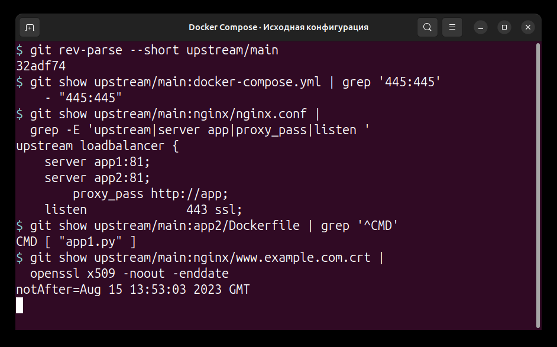
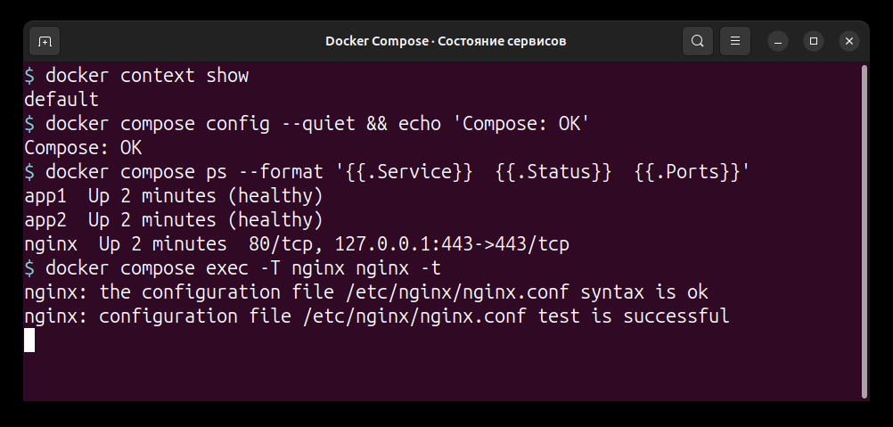
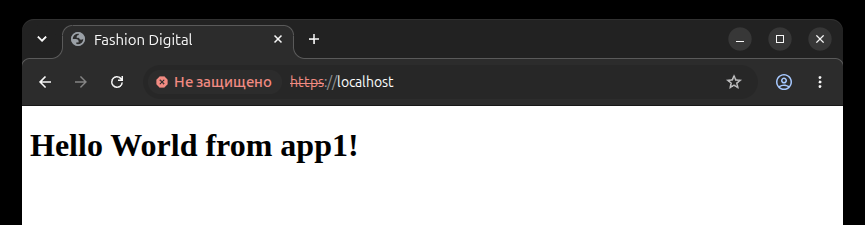
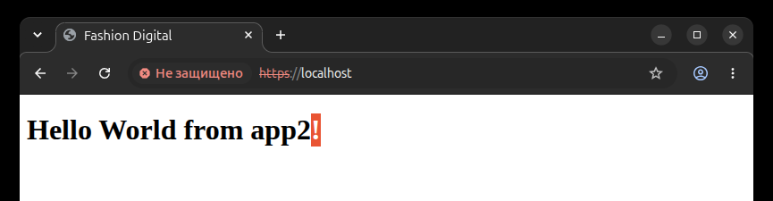
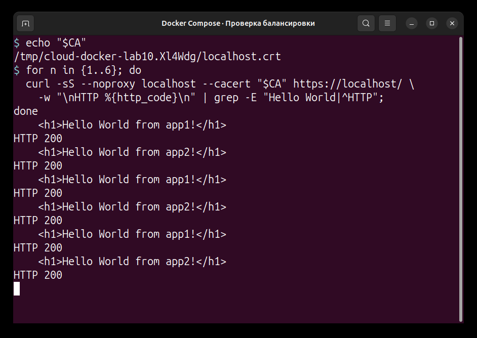

# Практическая работа 10 Docker Compose

Фамилия: Бромбин. Группа: МПрВИС21.

Цель работы — открыть `https://localhost/` и при обновлении страницы увидеть по очереди приветствия от двух Flask-приложений. Nginx завершает TLS-соединение и передаёт запрос одному из приложений по HTTP.

## Шаг 1. Анализ исходной конфигурации

Проверил порты, маршруты, шаблон страницы и настройки TLS в [исходной конфигурации](https://github.com/cloudmentio-course/docker-lab10/tree/32adf74ab8df5b32f8753e1fb431c86b1a766705).

| Участок | Исходная конфигурация и последствие | Исправление |
| --- | --- | --- |
| Публикация HTTPS | Compose публиковал `445:445`, а Nginx слушал 443. Адрес без явного порта был недоступен. | Опубликован `127.0.0.1:443:443`. Порты приложений доступны внутри сети Compose. |
| Группа серверов | Для `proxy_pass` было указано имя `app`, хотя группа называлась `loadbalancer`. | `proxy_pass http://loadbalancer` использует объявленную группу. |
| Порты приложений | Nginx обращался к обоим приложениям на порт 81. В Python были указаны 8080 и 80. | Оба приложения и оба адреса в группе Nginx используют порт 8080. |
| Запуск второго приложения | В образе app2 находился файл `app2.py`, а команда запуска указывала на отсутствующий `app1.py`. В обоих Python-файлах был включён отладчик. | Gunicorn запускает `app1:app` и `app2:app` от пользователя `www`. При прямом запуске отладчик также выключен. |
| Корневой маршрут | Оба обработчика принимали запросы только на `/hello`. | Приветствие доступно на `/` и на прежнем маршруте `/hello`. |
| Общий шаблон | Compose монтировал файлы в `/storage`, а Flask искал их в каталоге `templates` рядом с модулем. | Каталог `storage` подключён к каждому приложению как `/app/templates:ro`. |
| Приветствие | app2 не передавал `source_app` в шаблон. В начале заголовка страницы стоял закрывающий тег `</h1>`. | Каждый обработчик подставляет своё имя. Приветствие заключено в пару тегов `<h1>…</h1>`. |
| Сертификат и ключ | Конфигурация ссылалась на файлы для `www.example.com`, которые Dockerfile не копировал в образ. В исходном сертификате отсутствовало имя localhost, срок действия истёк 15.08.2023. | Скрипт запуска создаёт сертификат с именами `DNS:localhost` и `IP:127.0.0.1`. Пути к нему и ключу заданы в конфигурации Nginx. Удалены старая пара файлов и поддержка TLS 1.0/1.1. |
| Очерёдность | Метод `least_conn` выбирал сервер по числу активных соединений. Для демонстрации требуется последовательное чередование. | Используется round-robin с общей для рабочих процессов зоной `backends`. На запрос значка страницы отвечает сам Nginx. |
| Готовность приложений | `depends_on` задавал порядок запуска контейнеров. Прокси мог начать работу до готовности обработчиков. | Проверка каждого приложения запрашивает `/`. Запуск Nginx зависит от состояния `service_healthy` обоих приложений. |



*Шаг 1. Выдержки из исходного коммита показывают несовпадающие порты, неверную команду запуска app2 и дату окончания действия сертификата.*

## Шаг 2. Сборка и запуск

Команды выполняются из корня репозитория. Для запуска нужен свободный локальный TCP-порт 443.

```sh
docker compose config -q
docker compose up --build -d --wait
docker compose ps
docker compose exec -T nginx nginx -t
```

Все три контейнера запустились. У app1 и app2 появился статус `healthy`. Nginx принял конфигурацию и опубликовал порт 443 на локальном интерфейсе. В двух отдельных соединениях OpenSSL подтвердил согласование TLS 1.2 и TLS 1.3, проверку сертификата и имени localhost. Внутри сети Nginx обращается к приложениям по именам сервисов Compose.



*Шаг 2. Два приложения готовы принимать запросы. Nginx работает на локальном порту 443.*

## Шаг 3. Проверка HTTPS и балансировки

Открыл `https://localhost/` в браузере с самоподписанным сертификатом стенда и обновил страницу. По одному адресу появились оба приветствия. Пометка браузера «Не защищено» связана с тем, что самоподписанный сертификат отсутствует в его хранилище доверенных сертификатов.



*Шаг 3. Приложение app1 вернуло заголовок Hello World from app1!*



*Шаг 3. После одного обновления той же страницы приложение app2 вернуло заголовок Hello World from app2!*

Для независимой проверки взял публичный сертификат из контейнера и передал его curl. Команды выводят приветствие и HTTP-статус каждого ответа.

```sh
cert=$(mktemp)
docker compose exec -T nginx cat /etc/nginx/tls/localhost.crt > "$cert"
for i in 1 2 3 4 5 6; do
  curl --silent --show-error --fail --cacert "$cert" \
    --write-out '\nHTTP %{http_code}\n' https://localhost/ | grep -E '<h1>|^HTTP'
done
rm -f "$cert"
```



*Шаг 3. Во всех шести ответах получен HTTP 200. Имена app1 и app2 чередуются, каждое встречается трижды.*

Отдельная серия из шести запросов на `/hello` также прошла с HTTP 200 и чередованием приложений. Для остановки стенда из корня репозитория выполняется `docker compose down`.

## Вывод

При обновлении `https://localhost/` адрес остаётся прежним, а имя в заголовке меняется между app1 и app2. Так в браузере виден результат распределения запросов через один HTTPS-вход.
